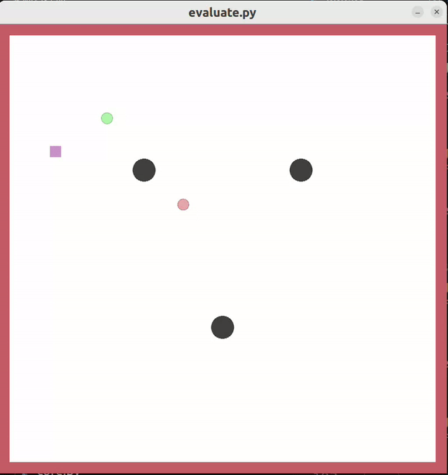

# Vision-Based Pursuit Evasion with PPO

This is a vision-based continuous-control project built on the
[OpenAI Multi-Agent Particle Environments](https://github.com/openai/multiagent-particle-envs).
A learned prey agent must reach a target region while avoiding a rule-based
predator, three fixed obstacles, and the arena boundary. 



## Algorithm

### 1. Visual perception and state estimation

At every control step, the environment renders an `800 × 800` RGB frame.
Color thresholding, morphological filtering, and connected-component analysis
locate the prey, predator, target, and obstacles. Detected pixel centers are
mapped to the normalized world coordinate system `[-1, 1]²`. Prey and predator
velocities are estimated from consecutive frames and smoothed with an
exponential moving average.

Let `pᵉ`, `pᵖ`, and `pᵍ` denote the prey, predator, and target positions;
`pᵒⁱ` the three obstacle positions; and `vᵉ`, `vᵖ` the estimated velocities.
The policy receives the following 16-dimensional state:

```text
sₜ = [pᵍ-pᵉ, pᵉ, pᵖ-pᵉ, pᵒ¹-pᵉ, pᵒ²-pᵉ, pᵒ³-pᵉ, vᵉ, vᵖ] ∈ R¹⁶
```

### 2. PPO continuous-control policy

The controller uses separate Actor and Critic multilayer perceptrons. Each
network contains two hidden layers with 128 units and `Tanh` activations. The
Actor parameterizes a two-dimensional Gaussian policy; a final `tanh`
transformation bounds the sampled action to `[-1, 1]²`. The resulting values
are mapped to horizontal and vertical prey acceleration. The Critic estimates
the state value `V(sₜ)`.

Training uses the PPO clipped objective with Generalized Advantage Estimation
(GAE). The probability-ratio clipping range is `1 ± 0.2`, with `γ = 0.99` and
`λ = 0.95`. Value loss, entropy regularization, and gradient clipping improve
optimization stability. The reward combines progress toward the target, a
per-step cost, predator and obstacle risk, near-target velocity shaping, and
an action-smoothness penalty, together with terminal rewards for success,
collision, and timeout.

### 3. Curriculum learning and target-entry fine-tuning

During the first 10,000 environment steps, the predator remains stationary so
that the policy can learn basic target navigation. Over the next 80,000 steps,
the predator speed, acceleration, and initial-distance constraints are
gradually restored to full difficulty.

After PPO training, a velocity-feedback expert generates near-target samples
for a small behavior-cloning update. The original policy is distilled outside
the target region to preserve its learned avoidance behavior. This stage
improves braking, alignment, and reliable entry into the target region.

### 4. Predictive safety layer

During evaluation and demonstration, a lightweight safety layer screens the
PPO action using a five-step forward simulation based only on image-derived
positions and velocities. It computes the minimum predicted clearance from
the predator, obstacles, and arena boundary.

- If the nominal PPO action is safe, it is applied unchanged.
- If a collision is predicted, the layer evaluates braking and directional
  acceleration candidates at multiple magnitudes.
- If safe candidates exist, it selects the one closest to the PPO action in
  Euclidean distance; otherwise, it selects the action with the largest
  predicted clearance.

The safety layer intervenes only for short-horizon collision risks. PPO remains
responsible for the primary navigation behavior.

## Requirements

- Python 3.10 or later
- PyTorch 2.0 or later
- Gymnasium, NumPy, OpenCV, Pillow, Matplotlib, and Pyglet

Install the dependencies from the project root:

```bash
python -m pip install -r requirements.txt
python -m pip install -e .
```

## Pretrained model and demo

The repository includes the final policy at `checkpoint/best_model.pt`.
`demo.py` loads this checkpoint by default:

```bash
python demo.py --episodes 3
```

## Training

The default configuration trains for 500,000 environment steps:

```bash
python train.py
```

## Evaluation

Run 500 reproducible randomized episodes with the included model:

```bash
python evaluate.py \
  --model checkpoint/best_model.pt \
  --episodes 500 \
  --output outputs/eval_results.csv
```

The evaluator reports success, obstacle collision, predator capture, timeout,
successful-episode length, path efficiency, goal progress, safety-layer
intervention rate, and mean reward.

## Third-party code and licenses

The `multiagent/` environment code and `make_env.py` are adapted from
[OpenAI Multi-Agent Particle Environments](https://github.com/openai/multiagent-particle-envs),
originally released under the MIT License, Copyright (c) 2018 OpenAI. The
original license is included in
[`LICENSES/OpenAI-MPE-LICENSE.txt`](LICENSES/OpenAI-MPE-LICENSE.txt).

The local environment adds Gymnasium compatibility, a custom pursuit-evasion
scenario, fixed obstacles, target-region logic, and modified physics and
rendering interfaces. `multiagent/multi_discrete.py` is derived from an older
OpenAI Gym implementation, released under the MIT License, Copyright (c) 2016
OpenAI. Its license is included in
[`LICENSES/OpenAI-Gym-LICENSE.md`](LICENSES/OpenAI-Gym-LICENSE.md).

All original project code is released under the [MIT License](LICENSE).
Third-party components remain subject to their respective copyright notices
and licenses.
